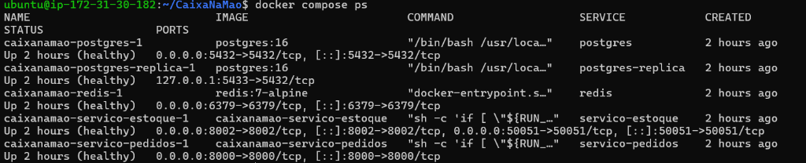
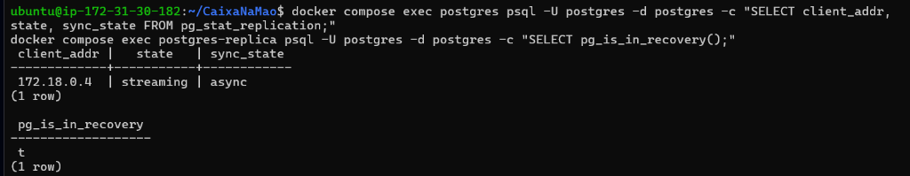
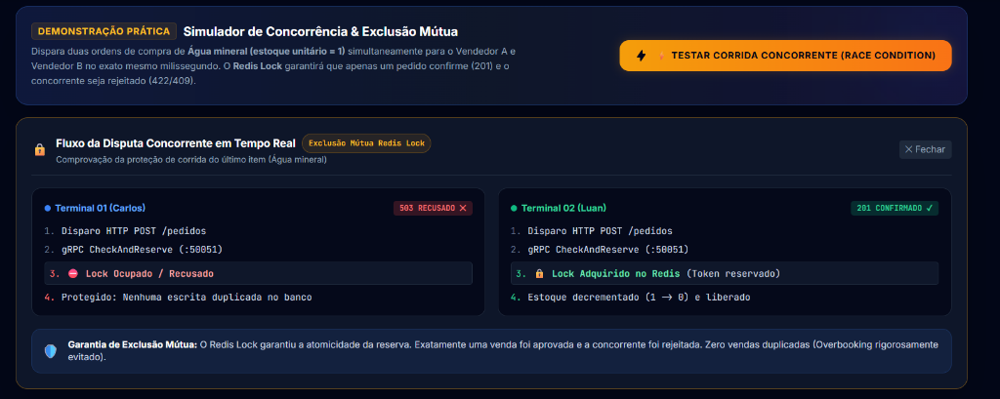
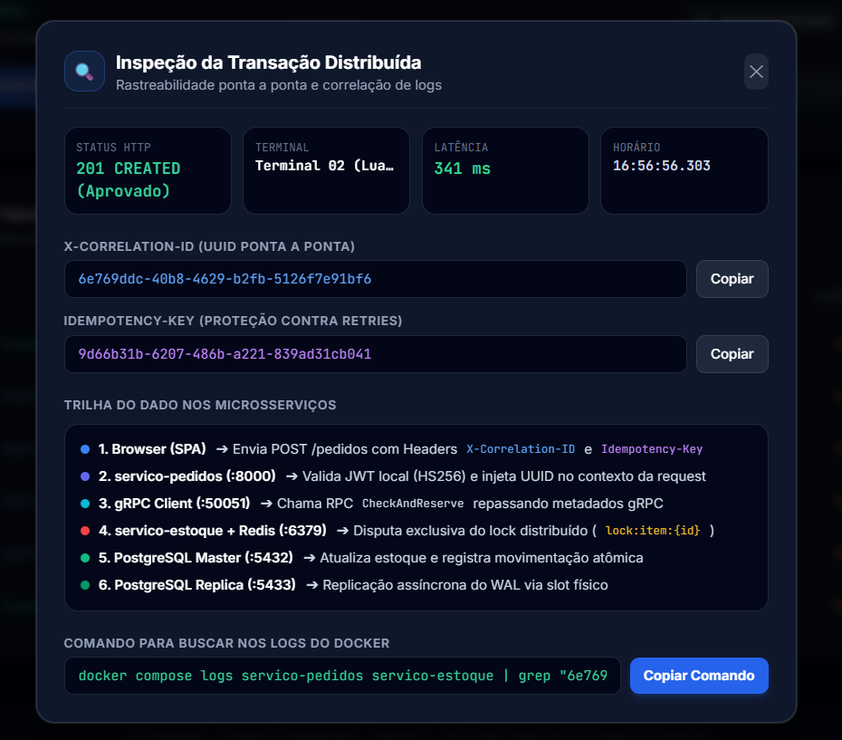
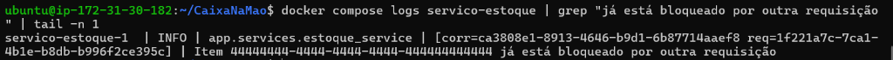

# Evidências de Homologação — Sprint 3 (AWS EC2)

Documento de evidências da **Sprint 3** do projeto **CaixaNaMão** (Sistemas Distribuídos).
Ambiente: Instância AWS EC2 (`t3.micro`, Ubuntu Server 24.04, `us-east-1`).

---

## 📋 Resumo das Evidências Coletadas

| # | Evidência | Requisito / Critério de Avaliação | Status |
|---|---|---|---|
| **01** | Orquestração Docker Compose na EC2 | 5 containers com healthchecks ativos e portas isoladas | ✅ Homologado |
| **02** | Replicação PostgreSQL Master/Replica | Streaming assíncrono do WAL via slot físico (`pg_is_in_recovery = true`) | ✅ Homologado |
| **03** | Exclusão Mútua com Redis Lock | Prevenção de race condition e overbooking (201 vs 409) | ✅ Homologado |
| **04** | Rastreabilidade Ponta a Ponta com UUID | Header `X-Correlation-ID` propagado do SPA ao log dos microsserviços | ✅ Homologado |
| **05** | Reset Idempotente de Demonstração | Script de recuperação automática com `seed_dev.sql` | ✅ Homologado |

---

## 1. Evidência 01: Orquestração dos Microsserviços (`docker compose ps`)

Todos os 5 serviços da arquitetura estão rodando na instância EC2 em estado **healthy**, com isolamento de rede e portas mapeadas.

```bash
ubuntu@ip-172-31-xx-xx:~/CaixaNaMao$ docker compose ps
```

**Saída Obtida:**
```text
NAME                            IMAGE                        COMMAND                   SERVICE            STATUS
caixanamao-postgres-1           postgres:16                  "/bin/bash /usr/loca…"    postgres           Up (healthy)
caixanamao-postgres-replica-1   postgres:16                  "/bin/bash /usr/loca…"    postgres-replica   Up (healthy)
caixanamao-redis-1              redis:7-alpine               "docker-entrypoint.s…"    redis              Up (healthy)
caixanamao-servico-estoque-1    caixanamao-servico-estoque   "sh -c 'if [ \"${RUN_…"   servico-estoque    Up (healthy)
caixanamao-servico-pedidos-1    caixanamao-servico-pedidos   "sh -c 'if [ \"${RUN_…"   servico-pedidos    Up (healthy)
```



---

## 2. Evidência 02: Replicação Master/Replica PostgreSQL

Comprovação de alta disponibilidade e consistência eventual com réplica de leitura em hot standby.

### 2.1 Verificação no Master (Status da Replicação WAL)
```bash
docker compose exec postgres psql -U postgres -d postgres -c \
  "SELECT client_addr, state, sync_state FROM pg_stat_replication;"
```
**Saída:**
```text
 client_addr |   state   | sync_state 
-------------+-----------+------------
 172.18.0.4  | streaming | async
(1 row)
```

### 2.2 Verificação na Réplica (Hot Standby Mode)
```bash
docker compose exec postgres-replica psql -U postgres -d postgres -c \
  "SELECT pg_is_in_recovery();"
```
**Saída:**
```text
 pg_is_in_recovery 
-------------------
 t
(1 row)
```



---

## 3. Evidência 03: Exclusão Mútua Distribuída (Redis Lock)

Dois vendedores (Terminal 01 - Carlos e Terminal 02 - Luan) tentaram comprar o último item de **Água mineral (estoque unitário = 1)** simultaneamente no mesmo milissegundo (`Promise.all`).

* **Terminal 01 (Vencedor):** `HTTP 201 Created` — Adquiriu o Lock no Redis (`lock:item:4444...`), decrementou o estoque de 1 para 0.
* **Terminal 02 (Perdedor):** `HTTP 409 Conflict / 503 Recusado` — Bloqueado pelo Redis Lock antes de tocar o banco de dados.
* **Resultado:** **Zero Overbooking**. O estoque final permaneceu exatamente em 0 un, sem saldo negativo nem venda fantasma.



---

## 4. Evidência 04: Rastreabilidade Distribuída Ponta a Ponta com UUID

Cada requisição gera um UUID v4 no header `X-Correlation-ID`, transmitido transparentemente por toda a cadeia de microsserviços.

### 4.1 Inspeção no Modal da Interface
O modal decompõe a trilha distribuída:
1. Browser (SPA) injeta `X-Correlation-ID`
2. `servico-pedidos` valida JWT e propaga o UUID
3. Chamada gRPC repassa metadata ao `servico-estoque`
4. `servico-estoque` disputa o Redis Lock registrando o UUID nos logs



### 4.2 Correlação nos Logs do Docker
Filtrando os logs com o UUID inspecionado:
```bash
docker compose logs servico-estoque | grep "já está bloqueado por outra requisição" | tail -n 1
```
**Saída nos logs do container:**
```text
servico-estoque-1  | INFO | app.services.estoque_service | [corr=ca3808e1-8913-4646-b9d1-6b87714aaef8 req=1f221a7c-...] | Item 44444444-4444-4444-4444-444444444444 já está bloqueado por outra requisição
```



---

## 5. Evidência 05: Reset Rápido do Estoque (1-Clique)

Execução do script `reset_estoque.bat` na máquina local que se conecta via SSH na EC2 e restaura os dados com `seed_dev.sql` idempotente (`ON CONFLICT DO UPDATE`).

```text
==========================================================
  🔄 CaixaNaMão — Restaurando Estoque para a Demonstração
==========================================================
>> Executando seed_dev.sql no container PostgreSQL (estoque_db)...
INSERT 0 4

>> Saldos atualizados no banco de dados:
       nome        | quantidade_disponivel | preco 
-------------------+-----------------------+-------
 Água mineral      |                     1 |  3.00
 Coxinha           |                    10 |  5.50
 Pastel de carne   |                     5 |  7.00
 Refrigerante lata |                    20 |  6.00
(4 rows)

>> Limpando eventuais travas residuais de teste no Redis...
0
==========================================================
  ✅ Estoque restaurado com sucesso!
```

> **[Print 05]:** *Janela do terminal do Windows após executar o `reset_estoque.bat` com sucesso.*
