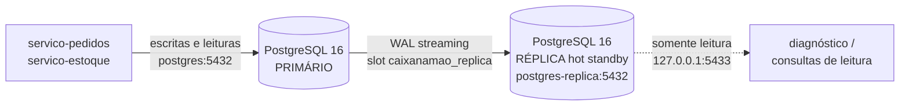

# Replicação PostgreSQL Master/Slave (Sprint 3 — issue #11)

> **Status:** implementado e validado em 2026-10-22
>
> **Serviços:** `postgres` (primário), `replicacao-init` (bootstrap) e `postgres-replica` (hot standby)
>
> **Decisão registrada em:** [ADR-007](decisoes-tecnicas.md#adr-007-replicação-streaming-assíncrona-com-hot-standby-e-promoção-manual)

## 1. Objetivo

O ADR-003 mantém **um único cluster PostgreSQL 16** com três databases lógicos
(`pedidos_db`, `estoque_db`, `autenticacao_db`). Isso simplifica a operação, mas cria um
**ponto único de falha**: se o container do banco cair, todos os microsserviços param.

Esta entrega adiciona **replicação física master/slave** (streaming replication) ao cluster:

- **Primário (`postgres`)**: recebe todas as escritas e serve os microsserviços.
- **Réplica (`postgres-replica`)**: cópia física em **hot standby**, somente leitura,
  pronta para assumir após **promoção manual**.
- **Bootstrap (`replicacao-init`)**: one-shot idempotente que cria o papel de replicação
  e o slot físico antes de a réplica subir.

O escopo é **infraestrutura**: nenhuma string de conexão dos serviços mudou — as escritas
continuam no primário, o que preserva a consistência forte exigida pelo controle de estoque
(ADR-004). A réplica habilita leitura/diagnóstico e é a base para failover.

## 2. Arquitetura



### 2.1 Componentes do `docker-compose.yml`

| Serviço | Papel | Porta no host | Volume |
|---|---|---|---|
| `postgres` | Primário (master) | `5432` | `postgres_data` |
| `replicacao-init` | One-shot: papel `replicator` + slot físico | — | — |
| `postgres-replica` | Réplica hot standby (slave) | `127.0.0.1:5433` | `postgres_replica_data` |

A réplica **não** participa do caminho de escrita dos serviços. Ela fica exposta apenas no
loopback (`127.0.0.1:5433`) para diagnóstico e consultas de leitura na máquina host; na
rede do Compose, os serviços a alcançam como `postgres-replica:5432`.

### 2.2 Fluxo de inicialização

1. `postgres` sobe com `wal_level=replica` e, em todo start, garante no `pg_hba.conf` a
   regra `host replication replicator all scram-sha-256` (o entrypoint
   `infra/postgres/primary-entrypoint.sh` cobre volumes criados nas Sprints 1/2; em
   volumes novos, o hook `infra/postgres/initdb-replicacao.sh` roda logo após o initdb e
   adiciona a mesma regra).
2. `replicacao-init` conecta por TCP como superusuário e executa
   `infra/replicacao/init-replicacao.sql` — idempotente:
   - `CREATE ROLE replicator WITH LOGIN REPLICATION` (senha vinda de `REPLICATION_PASSWORD`);
   - `pg_create_physical_replication_slot('caixanamao_replica')`.
3. `postgres-replica` espera o primário, roda `pg_basebackup` com o slot e escreve
   `standby.signal` + `postgresql.auto.conf` (`primary_conninfo`, `primary_slot_name`).
4. O PostgreSQL da réplica entra em recovery contínua: `hot_standby=on` permite consultas,
   `hot_standby_feedback=on` reduz conflitos entre consultas longas e o `VACUUM` do primário,
   e `recovery_target_timeline='latest'` acompanha mudanças de timeline após promoção.
5. Em starts seguintes, o marcador `$PGDATA/.replica_clonada` evita novo clone: a réplica
   apenas retoma o streaming. O `.pgpass` (0600, fora do volume de dados) é reescrito e
   reutilizado pelo WAL receiver, então a senha não fica gravada no `PGDATA`.

## 3. Configuração aplicada

| Parâmetro | Onde | Valor | Por quê |
|---|---|---|---|
| `wal_level` | primário | `replica` | Nível mínimo para enviar WAL a um standby físico |
| `max_wal_senders` | primário | `10` | Espaço para a réplica atual + reconexões/diagnóstico |
| `max_replication_slots` | primário | `10` | Um slot físico por réplica, com folga |
| `wal_keep_size` | primário | `512MB` | Retenção extra de WAL se a réplica ficar fora |
| `max_slot_wal_keep_size` | primário | `2GB` | Teto de disco: evita WAL infinito com réplica parada; acima disso o slot é invalidado e exige re-clone |
| `hot_standby` | primário e réplica | `on` | Permite que a réplica atenda consultas e que um primário promovido aceite réplicas |
| `primary_slot_name` | réplica | `caixanamao_replica` | Retém o WAL não consumido no primário |
| `primary_conninfo` | réplica | `application_name=postgres-replica` | Identifica o WAL receiver em `pg_stat_replication` |
| `hot_standby_feedback` | réplica | `on` | Evita remoção de tuplas ainda visíveis em consultas da réplica |
| `recovery_target_timeline` | réplica | `latest` | Segue a timeline vigente após promoção |

## 4. Como subir

```bash
# stack completa (inclui a réplica e o bootstrap)
docker compose up -d --build

# ou apenas banco + réplica
docker compose up -d postgres postgres-replica
```

A senha do papel de replicação vem de `REPLICATION_PASSWORD` (`.env`, não versionado). O
`.env.example` traz o default de desenvolvimento; `scripts/deploy.sh` gera um valor
aleatório quando cria o `.env`.

Em homologação, o `deploy.sh` **não** inclui a réplica na lista padrão de serviços porque a
instância `t3.micro` tem 1 GB de RAM (ver `docs/deploy-aws.md`). Para subir com ela:

```bash
SERVICOS="postgres postgres-replica redis servico-estoque servico-pedidos" bash scripts/deploy.sh
```

## 5. Validação

O script abaixo sobe os três serviços e executa verificações reais, com código de saída
diferente de zero se qualquer uma falhar:

```bash
bash scripts/validar_replicacao.sh
```

Saída executada em **22/10/2026** nesta máquina:

```text
==> subindo primário, bootstrap da replicação e réplica
 Container caixanamao-postgres-1 Running
 Container caixanamao-postgres-replica-1 Running
 Container caixanamao-replicacao-init-1 Started
 Container caixanamao-replicacao-init-1 Exited
==> aguardando o hot standby aceitar consultas (até 120s)

==> verificações
  [OK]    réplica em recovery (pg_is_in_recovery = true)
  [OK]    primário com WAL sender em streaming para postgres-replica
  [OK]    primário com wal_level = replica
  [OK]    slot físico caixanamao_replica presente no primário
  [OK]    os 3 databases lógicos existem na réplica
  [OK]    escrita no primário (pedidos_db) visível na réplica em <20s
  [OK]    réplica recusa escrita (read-only transaction)

==> pg_stat_replication (primário)
 application_name |   state   | sync_state | lag_bytes
------------------+-----------+------------+-----------
 postgres-replica | streaming | async      |         0
(1 row)

==> REPLICAÇÃO VALIDADA: 7/7 verificações passaram
```

O log do `pg_basebackup` no primeiro start da réplica mostra o clone e a entrada em standby:

```text
pg_basebackup: base backup completed
==> [postgres-replica] clone concluído — iniciando hot standby
LOG:  entering standby mode
LOG:  consistent recovery state reached at 0/3000100
LOG:  database system is ready to accept read-only connections
LOG:  started streaming WAL from primary at 0/4000000 on timeline 1
```

### 5.1 O que o script comprova

1. `pg_is_in_recovery()` é `true` na réplica;
2. `pg_stat_replication` no primário tem `postgres-replica` em `state = streaming`;
3. o primário está com `wal_level = replica`;
4. o slot físico `caixanamao_replica` existe;
5. os três databases lógicos foram replicados;
6. um `INSERT` no primário aparece na réplica (consistência dos dados);
7. um `CREATE TABLE` na réplica falha com `read-only transaction`.

O script remove a tabela temporária de validação ao final, inclusive quando algo falha.

## 6. Monitoramento

No primário:

```sql
SELECT application_name, state, sync_state,
       pg_wal_lsn_diff(sent_lsn, replay_lsn) AS lag_bytes,
       replay_lag
  FROM pg_stat_replication;

SELECT slot_name, active, wal_status,
       pg_size_pretty(pg_wal_lsn_diff(pg_current_wal_lsn(), restart_lsn)) AS wal_retido
  FROM pg_replication_slots;
```

Na réplica:

```sql
SELECT pg_is_in_recovery(), now() - pg_last_xact_replay_timestamp() AS atraso_replay;
```

Interpretação rápida:

- `state = streaming` e `lag_bytes` próximo de zero → replicação saudável.
- `active = false` no slot → réplica desconectada; o WAL continua retido até o teto.
- `wal_status = lost` → o slot foi invalidado por `max_slot_wal_keep_size`; é preciso
  re-clonar a réplica (seção 7.2).

## 7. Operação

### 7.1 Promoção manual da réplica (failover)

Não há failover automático nesta entrega (ver seção 8). Quando o primário estiver
irrecuperável, a promoção é deliberada e exige atualizar as strings de conexão:

```bash
# 1. Garanta que o primário antigo não volte a aceitar escritas
docker compose stop postgres

# 2. Promova a réplica (pg_promote remove o standby.signal e abre para escrita)
docker compose exec -T postgres-replica psql -U postgres -d postgres -c \
  "SELECT pg_promote(wait => true);"

# 3. Confirme que saiu da recovery (retorno esperado: f)
docker compose exec -T postgres-replica psql -U postgres -d postgres -tAc \
  "SELECT pg_is_in_recovery();"

# 4. Reponte os serviços para postgres-replica:5432 no DATABASE_URL e recrie-os
docker compose up -d --force-recreate servico-pedidos servico-estoque
```

> **Split-brain:** nunca deixe o primário antigo subir como primário depois da promoção.
> O caminho correto é recriá-lo como nova réplica (idealmente com `pg_rewind`); em
> desenvolvimento, o re-clone da seção 7.2 é suficiente.

### 7.2 Re-clone da réplica

Use quando o volume da réplica ficou inconsistente, o slot foi invalidado ou o primário
foi recriado (o `pg_basebackup` novo é feito automaticamente):

```bash
docker compose stop postgres-replica
docker compose rm -f postgres-replica
docker volume rm caixanamao_postgres_replica_data   # confira com: docker volume ls
docker compose up -d postgres-replica
```

O volume `postgres_data` (primário) **não** é tocado.

### 7.3 Diagnóstico de falhas comuns

| Sintoma no log | Causa provável | Correção |
|---|---|---|
| `no pg_hba.conf entry for replication connection` | volume antigo sem a regra de replicação | reinicie o primário (`docker compose restart postgres`); o entrypoint adiciona a regra |
| `replication slot "caixanamao_replica" does not exist` | `replicacao-init` falhou | `docker compose logs replicacao-init` e suba de novo |
| `database system identifier differs` | primário recriado com volume novo | re-clone da réplica (7.2) |
| `requested WAL segment ... has already been removed` | slot invalidado / WAL reciclado | re-clone da réplica (7.2) |
| réplica `healthy` mas `lag_bytes` crescendo | rede/IO do primário ou consulta longa bloqueando replay | verificar `pg_stat_replication`, `pg_stat_activity` e `pg_stat_database_conflicts` |

## 8. Garantias e limitações (honestidade técnica)

| Aspecto | Garantia nesta entrega |
|---|---|
| **Consistência** | Física: a réplica é uma cópia bloco a bloco do primário. Escritas dos serviços permanecem **somente** no primário. |
| **RPO (perda máxima)** | **> 0** — replicação **assíncrona**: uma queda do primário pode perder as transações ainda não enviadas (tipicamente milissegundos, mas sem limite contratual). |
| **RTO (tempo de recuperação)** | **Manual**: promoção + repontamento dos serviços. Não é automático. |
| **Failover automático** | **Fora do escopo.** Exigiria Patroni/repmgr ou equivalente, com consenso e quórum — custo operacional incompatível com a instância `t3.micro` do laboratório. |
| **Leitura na réplica** | Disponível em `postgres-replica:5432` / `127.0.0.1:5433`, mas **não** roteada pelos serviços nesta issue. Leitura na réplica pode estar defasada (read-after-write não garantido). |
| **Disco do primário** | Limitado por `max_slot_wal_keep_size=2GB`; se a réplica ficar tempo demais fora, o slot é invalidado e o re-clone é necessário. |

A replicação **síncrona** (`synchronous_commit=on` + `synchronous_standby_names`) foi
rejeitada como default: ela reduziria o RPO a zero, mas todo `COMMIT` passaria a depender
da réplica — com a réplica fora, as escritas do primário bloqueiam ou falham, o que quebra
a stack de desenvolvimento (que pode subir só o primário) e troca um ponto de falha por
outro. Ela permanece como evolução possível para produção (ADR-007).

## 9. Fora de escopo / próximos passos

- Failover automático e quórum (Patroni/repmgr) — Sprint 4+.
- Roteamento de leitura nos serviços (réplica para `SELECT`) com política de consistência
  explícita; hoje os serviços usam apenas o primário.
- Backup lógico independente da replicação (`pg_dump`/WAL archiving) — replicação **não**
  substitui backup.
- TLS entre primário e réplica (issue #17) e métricas de replicação no monitoramento
  (issue #16).
