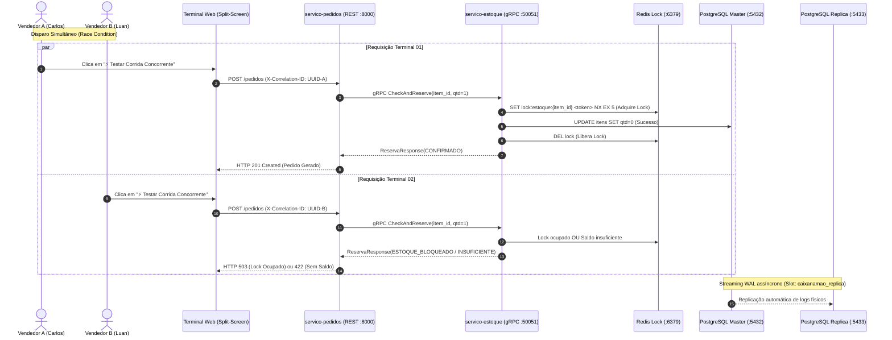

# Roteiro de Demonstração Prática — Sprint 3

> **Projeto:** CaixaNaMão  
> **Sprint:** 3 — Integridade Distribuída, Exclusão Mútua e Replicação  
> **Issue:** #39 — "Painel de Concorrência e Rastreabilidade UUID (Redis Lock & Telemetria)"  
> **Autores:** Carlos Barbosa, Eduardo Tenório, Luan Dias  
> **Última atualização:** 2026-11-02  

---

## 1. Visão Geral e Objetivos da Demonstração

Este roteiro fornece o passo a passo completo e infalível para a equipe conduzir a apresentação prática da **Sprint 3** para o professor e avaliadores da disciplina de **Sistemas Distribuídos**.

O foco da demonstração é comprovar na prática, ao vivo:
1. **Exclusão Mútua Distribuída:** Garantia de que dois vendedores ambulantes não consigam comprar simultaneamente a última unidade de um item (*Race Condition* evitada via **Redis Lock**).
2. **Rastreabilidade Transacional Ponta a Ponta:** Correlação de cada requisição via **UUID** (`X-Correlation-ID`) desde o clique no navegador até os logs do FastAPI e do gRPC no Docker.
3. **Replicação PostgreSQL Master/Slave:** Comprovação de streaming replication assíncrono com nó de leitura dedicado (*Hot Standby*).
4. **Resiliência e Idempotência:** Prevenção de duplicidade com `Idempotency-Key`.

---

## 2. Preparação do Ambiente (Antes da Apresentação)

Execute estes passos na máquina da apresentação 5 minutos antes de iniciar.

### Passo 2.1 — Subir os Contêineres Docker

Na raiz do repositório:
```bash
# Subir toda a infraestrutura e microsserviços
docker compose up -d --build
```

Aguarde cerca de 20 segundos até que todos os serviços fiquem `healthy`:
```bash
docker compose ps
```

*Saída esperada:*
- `postgres`: Up (healthy) na porta 5432
- `postgres-replica`: Up (healthy) na porta 5433
- `redis`: Up (healthy) na porta 6379
- `localstack`: Up na porta 4566
- `servico-estoque`: Up (healthy) na porta 50051 (gRPC) e 8002 (HTTP)
- `servico-pedidos`: Up (healthy) na porta 8000 (HTTP/SPA)

---

### Passo 2.2 — Aplicar a Carga Inicial de Dados (Seed Dev)

Garante que o catálogo inicial contenha os 4 produtos e que a **Água mineral** tenha exatamente **1 unidade** no estoque:
```bash
docker compose exec -T postgres psql -U postgres -d estoque_db < scripts/seed_dev.sql
```

Para conferir o saldo inicial:
```bash
docker compose exec -T postgres psql -U postgres -d estoque_db -c \
  "SELECT id, nome, quantidade_disponivel, quantidade_reservada FROM itens;"
```

---

### Passo 2.3 — Abrir o Terminal Web

Abra o navegador no endereço:
```
http://localhost:8000/
```

Você verá a interface Dark Mode do **CaixaNaMão** com os dois terminais em **Split-Screen**:
- **Terminal 01:** Vendedor A (Carlos)
- **Terminal 02:** Vendedor B (Luan / Eduardo)

---

## 3. Arquitetura da Demonstração

O fluxo distribuído executado a cada venda é ilustrado no diagrama abaixo:



---

## 4. Roteiro de Demonstração ao Vivo (Passo a Passo para a Banca)

### Bloco 1: Apresentação da Interface e Autenticação (2 minutos)

1. **Apresente o problema de negócio:**
   > *"O CaixaNaMão é uma plataforma para vendedores ambulantes em eventos de grande porte (estádios, praia, carnaval). Em alta concorrência, dezenas de vendedores tentam vender os mesmos produtos simultaneamente a partir de caixas térmicas e pontos de distribuição compartilhados."*

2. **Destaque a arquitetura Zero-Bloat:**
   > *"Para máxima agilidade e economia de recursos no contêiner, a interface gráfica é uma Single-Page Application desenvolvida puramente em HTML5, Tailwind CSS e Vanilla JavaScript, servida diretamente pelo FastAPI na porta 8000, sem exigir Node.js ou npm."*

3. **Mostre os dois terminais independentes:**
   - Destaque o **Terminal 01 (Carlos)** e o **Terminal 02 (Luan)**;
   - Explique que cada terminal possui sua própria identidade JWT (HS256) validada localmente pelo `servico-pedidos` (ADR-001), eliminando chamadas síncronas de rede ao serviço de autenticação no momento da venda.

---

### Bloco 2: A Prova Concorrente (Race Condition ao Vivo) (4 minutos)

1. **Aponte para o item de teste:**
   - Mostre no catálogo que a **Água mineral** possui um badge de destaque âmbar com o aviso: `⚡ 1 un restante!`.

2. **Explique a condição de corrida:**
   > *"Temos apenas 1 unidade de água mineral disponível no estoque central. Se Carlos e Luan venderem essa água no mesmo milissegundo, uma arquitetura comum sem controle de concorrência cometeria venda dupla (overbooking)."*

3. **Clique no botão:**
   - Clique em **`⚡ Testar Corrida Concorrente (Race Condition)`** no topo da tela;
   - O JavaScript dispara simultaneamente via `Promise.all` as duas requisições `POST /pedidos` com identidades, `Idempotency-Key` e `X-Correlation-ID` próprios.

4. **Mostre o resultado visual em tempo real:**
   - **Um dos terminais** recebe feedback verde: `✅ HTTP 201 Created: Pedido confirmado`;
   - **O outro terminal** recebe feedback vermelho/alerta: `⚠️ HTTP 503 (lock ocupado) ou HTTP 422 (sem saldo)`;
   - O saldo da Água Mineral cai instantaneamente para **`0 un (Esgotado)`** e o botão de compra fica **desabilitado** em ambos os terminais.

---

### Bloco 3: Rastreabilidade Transacional Ponta a Ponta com UUID (3 minutos)

1. **Mostre o Painel de Auditoria na Interface:**
   - Na tabela inferior, aponte para as duas linhas geradas no exato mesmo segundo;
   - Mostre as colunas: `Horário`, `Terminal`, `Status HTTP (201 vs 503/422)`, `Latência (ms)` e o **`X-Correlation-ID`** (UUID).
   - Copie o UUID da transação rejeitada ou aprovada.

2. **Correlacione com os logs do Docker (Terminal de Comando):**
   Execute no terminal para provar que o mesmo UUID transitou por todos os microsserviços (nos logs estruturados, o header `X-Correlation-ID` é registrado como `[corr=<uuid> req=<uuid>]`):

   ```bash
   # Exemplo buscando pelo UUID da transação:
   docker compose logs servico-pedidos servico-estoque | grep "<UUID_COPIADO>"
   ```

   *O que o professor verá nos logs:*
   1. O `CorrelationMiddleware` do FastAPI recebendo o `X-Correlation-ID` no `servico-pedidos` e prefixando cada linha com `[corr=<uuid>]`;
   2. O cliente gRPC propagando o UUID nos metadados gRPC para o `servico-estoque`;
   3. O log do `RedisLockManager` registrando a aquisição (ou bloqueio concorrente em `lock:estoque:<item_id>`) com o mesmo `[corr=<uuid>]`.

---

### Bloco 4: Comprovação da Replicação PostgreSQL (2 minutos)

1. **Demonstre a gravação no Primário:**
   ```bash
   docker compose exec postgres psql -U postgres -d estoque_db -c \
     "SELECT nome, quantidade_disponivel, quantidade_reservada FROM itens WHERE nome = 'Água mineral';"
   ```
   *Resultado:* `quantidade_disponivel: 0`, `quantidade_reservada: 1`.

2. **Demonstre que a Réplica (Hot Standby) já está sincronizada:**
   ```bash
   docker compose exec postgres-replica psql -U postgres -d postgres -c \
     "SELECT pg_is_in_recovery();"
   ```
   *Resultado:* `t` (True, confirmando que é réplica em leitura contínua).

3. **Verifique o status do Replication Slot:**
   ```bash
   docker compose exec postgres psql -U postgres -d postgres -c \
     "SELECT slot_name, active, wal_status FROM pg_replication_slots;"
   ```
   *Resultado:* `caixanamao_replica | t | reserved`.

---

## 5. FAQ da Apresentação (Respostas para a Banca)

| Pergunta Provável do Professor | Resposta Técnica Objetiva |
| :--- | :--- |
| **Por que usar Redis Lock e não `SELECT ... FOR UPDATE` no PostgreSQL?** | Conforme a [ADR-004](decisoes-tecnicas.md#adr-004-redis-para-distributed-locking-na-reserva-de-estoque), locks pessimistas no banco seguram conexões ativas no pool de conexões do PostgreSQL durante I/O externo. O Redis Lock opera em memória (sub-milissegundo), protegendo a zona crítica sem sobrecarregar o banco relacional. |
| **O que acontece se o processo morrer com o lock adquirido?** | O lock possui TTL de segurança de 5 segundos (`LOCK_TTL_SECONDS=5`). Se o worker cair antes de liberar, o Redis expira a chave automaticamente, evitando deadlocks permanentes. |
| **E se uma operação demorar mais que o TTL do lock?** | Implementamos renovação assíncrona de lease (*watchdog/heartbeat*) em background via asyncio, além de reconferência estrita da posse do token antes do commit no banco de dados ([Issue #11/#12](consistencia-exclusao-mutua.md)). |
| **O que acontece se a rede cair e o cliente tentar reenviar o pedido?** | O `servico-pedidos` suporta o header opcional `Idempotency-Key` (UUID), enviado automaticamente pelo terminal web. Se a mesma chave for reenviada, a requisição devolve a resposta do pedido previamente gravado sem executar uma segunda reserva de estoque. |

---

## 6. Checklist de Sucesso da Apresentação

- [ ] Docker Compose subiu limpo (`docker compose ps` todos *healthy*);
- [ ] Catálogo inicial resetado via `seed_dev.sql`;
- [ ] Terminal Web acessível em `http://localhost:8000/`;
- [ ] Teste de concorrência disparado com sucesso (1 confirmação, 1 rejeição);
- [ ] UUID correlacionado no log do contêiner;
- [ ] Replicação do PostgreSQL comprovada via `pg_is_in_recovery()`.
